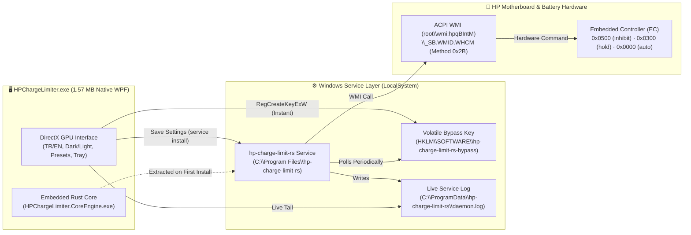

<div align="center">

<a href="README.md"></a>&nbsp;&nbsp;<a href="README.en.md"></a>

<br /><br />


# ⚡ HP Battery Charge Limiter

A modern, **zero-install (`1.57 MB` standalone `.exe`)**, **DirectX GPU-accelerated** desktop control center that enables hardware-level battery charge limiting for **HP Victus, OMEN, and Pavilion** laptops on Windows 10 & 11.

<p align="center">
  <a href="../../releases/latest"></a>&nbsp;
  <a href="https://github.com/kralonur/hp-charge-limit-rs"></a>&nbsp;
  <a href="#-key-features"></a>&nbsp;
  <a href="#-ai-assisted-development--credits"></a>&nbsp;
  <a href="#-license--legal-compliance"></a>
</p>

[**📥 Download (Releases)**](../../releases/latest) &nbsp;·&nbsp; [**💡 Quick Start Guide**](#-does-it-require-installation-how-to-use) &nbsp;·&nbsp; [**❓ FAQ**](#-frequently-asked-questions-faq) &nbsp;·&nbsp; [**📦 Changelog**](docs/CHANGELOG.md) &nbsp;·&nbsp; [**🔗 Upstream Source**](#-upstream-source--attribution)

</div>

---

## 💡 Does It Require Installation? How to Use?

### 1. No Installer Wizard (`.msi` / Setup) Required!
This application is a **single portable executable** (`HPChargeLimiter.exe` — only **`1.57 MB`**). You do **not** need to install Python, Rust, or any external driver package. The background Rust service (`hp-charge-limit-rs.exe`) is embedded directly inside this `.exe`.

### 2. Step-by-Step Usage (30 Seconds)
1. Download **`HPChargeLimiter.exe`** from the [**Releases**](../../releases/latest) section on the right and double-click to launch it.
2. Click **`EN`** in the top-right corner to switch the interface to English (your choice is saved automatically).
3. Under **Charge Limit & Thresholds**, select a Quick Preset (or customize the Stop/Start sliders):
   * **60% Desktop (`60% Stop / 55% Start`):** Best if your laptop stays plugged in 24/7 to minimize long-term chemical aging.
   * **80% Balanced — *Recommended* (`80% Stop / 75% Start`):** Ideal balance between daily unplugged runtime and battery longevity.
   * **90% Travel (`90% Stop / 85% Start`):** High capacity before travelling while avoiding peak 100% voltage stress.
4. Click **"💾 Save & Apply to Windows Service"** *(approve the Windows UAC prompt)*.
5. **That's it!** The top-right status badge will turn green: **`Service: RUNNING`**.

### 3. What Happens If I Close the App or Delete the `.exe`?
> [!IMPORTANT]
> Once you click **"Save & Apply to Windows Service"**, the application automatically extracts its embedded core engine to **`C:\Program Files\hp-charge-limit-rs\hp-charge-limit-rs.exe`** and registers it as a native **Windows Service (`LocalSystem`)**.
>
> Because of this architecture:
> * **Even if you completely close the GUI (`HPChargeLimiter.exe`)**, the background service keeps enforcing your limit 24/7.
> * **Even if you delete the downloaded `HPChargeLimiter.exe` file**, your charge limit remains active across every reboot (starting automatically before Windows sign-in).
> * Optionally, you can enable *"Start GUI in system tray on Windows boot"* under the **System & Preferences** tab to keep the tray icon handy at all times.

### 4. Complete Uninstall & Factory Reset (Zero Leftovers)
If you ever want to completely remove the service and all files from your PC:
1. Open `HPChargeLimiter.exe` and go to the **🖥️ System & Preferences** tab.
2. Click **"🧹 Full Uninstall & Clean All Leftovers"**.
3. With a single click, this will:
   * Reset the motherboard Embedded Controller (EC) back to factory default (**100% normal charging — `auto`**),
   * Stop and remove the Windows Service (`hp-charge-limit-rs`),
   * Delete `C:\Program Files\hp-charge-limit-rs`, `C:\ProgramData\hp-charge-limit-rs`, `%APPDATA%\HPChargeLimiter`, and all Registry entries with **zero leftovers**.

---

## ❓ Frequently Asked Questions (FAQ)

* **My battery is currently at 91%, and I set the limit to 80%. Why isn't it discharging down to 80%?**
  * This is **completely normal and by design**. Hardware charge inhibition (`Inhibit`) does not forcefully discharge your battery; instead, it cuts charging current to **`0.00 W`** and runs the laptop directly off AC adapter power. Force-discharging would waste battery cycle life, so the battery is held steady at its current level (91%). Once you use the laptop on battery below 80%, it will stop at 80% from then on.
* **I'm about to travel. Can I charge to 100% just once without losing my saved settings?**
  * Yes! Simply toggle on **"⚡ Temporary 100% Charge (Bypass)"** on the main screen (or from the system tray icon). Your battery will charge to 100%. The next time you restart Windows, Bypass automatically turns off and your normal charge limit is restored.
* **Which HP laptop models are supported?**
  * Works on **HP Victus 15 / 16**, **HP OMEN 16 / 17**, and modern **HP Pavilion Gaming / Aero** laptops that expose the `root\wmi:hpqBIntM` (`\_SB.WMID.WHCM`, method `0x2B`) ACPI WMI interface. You can verify your hardware compatibility anytime via **🛠️ Tools & Diagnostics -> Run Diagnostics**.

---

## ✨ Key Features

* **🚀 DirectX GPU-Accelerated Native UI (`1.57 MB`):** Built on Windows's native **WPF (`PresentationFramework` / DirectX)** engine instead of heavy Python/Electron bundles. Runs smoothly at **144Hz / 165Hz** and launches in `< 80 ms`.
* **☀️ / 🌙 Dark & Light Theme:** Instantly toggle between Dark Mode (Obsidian) and Light Mode (Slate), including the native Windows 11 DWM title bar.
* **🌐 Bilingual Interface (`TR` / `EN`):** Instant switching between English and Turkish with a fixed-grid layout so buttons and badges never shift.
* **ⓘ Smart Power-User Info Badges:** Hover or click the **`ⓘ`** badge next to any setting for a clear, concise explanation without overwhelming jargon.
* **🧪 Live Charge Flow Test (`--watch`) & Hardware Diagnostics (`diagnose`):** Samples real-time battery energy (`mWh` and `Watts`) to verify that charging current is physically blocked on your motherboard.

---

## 🏗️ System Architecture



---

## 📂 Repository Layout

```text
├── src/
│   └── v2-native-wpf/                   # 🚀 Native C# / DirectX WPF Source Code
│       ├── Program.cs                   # Single-instance mutex, DPI v2 & entry point
│       ├── MainWindow.cs                # DirectX GPU UI, Dark/Light theme, 5 tabs, system tray
│       ├── Backend.cs                   # Win32 P/Invoke, WMI/CLI bridge, Full Cleanup engine
│       ├── I18n.cs                      # Bilingual (TR / EN) dictionary
│       ├── app_icon.ico                 # Multi-layer (16px..256px) Fluent app icon
│       ├── build.ps1                    # Single-command C# / WPF build script (csc.exe)
│       └── core/
│           └── hp-charge-limit-rs.exe   # Upstream v0.4.1 Rust binary embedded at compile time
│
├── hp-charge-limit-rs-source/           # 🦀 v0.4.1 Upstream Rust Source Code (kralonur/hp-charge-limit-rs)
│
├── docs/
│   ├── logo.png                         # Application logo
│   ├── badges/                          # Smooth rounded SVG pill badges
│   ├── CHANGELOG.md                     # Release history
│   └── README_UPSTREAM.md               # Original hp-charge-limit-rs documentation
│
├── README.md                            # 🇹🇷 Turkish Documentation
├── README.en.md                         # 🇬🇧 English Documentation
├── LICENSE-MIT                          # Full MIT License text
├── LICENSE-APACHE                       # Full Apache 2.0 License text
├── NOTICE                               # Apache 2.0 Section 4 attribution & modification notice
└── THIRD_PARTY_NOTICES.md               # Third-party open-source notices
```

---

## 🔗 Upstream Source & Attribution

The hardware communication core and Windows background service (**daemon**) of this project are built upon the open-source **`hp-charge-limit-rs`** project created by **Onur Kral ([@kralonur](https://github.com/kralonur))** and contributors:

* **Original (Upstream) GitHub Repository:** [**https://github.com/kralonur/hp-charge-limit-rs**](https://github.com/kralonur/hp-charge-limit-rs)
* **Core Engine Version:** `v0.4.1` (Commit: `3cdff25dd11b05797b8f56a393a58fcc3e8d3a2c`)
* **Core Source Code:** [`hp-charge-limit-rs-source/`](hp-charge-limit-rs-source/) *(Preserved unmodified for hardware/EC safety)*
* **Original Documentation:** [`docs/README_UPSTREAM.md`](docs/README_UPSTREAM.md)

---

## 🤖 AI-Assisted Development & Credits

The native desktop graphical user interface (**Native C# / DirectX WPF GUI**), user experience (UX) design, Dark/Light theme engine, bilingual (`TR`/`EN`) architecture, zero-residue uninstaller (`FullSystemCleanup`), and documentation were co-developed with **Google Gemini (Argon) / Antigravity AI** (*AI-Assisted / Vibe-Coding*):

* **Core Rust Engine & ACPI WMI Research (`v0.4.1`):** [Onur Kral (@kralonur)](https://github.com/kralonur) — [`hp-charge-limit-rs`](https://github.com/kralonur/hp-charge-limit-rs)
* **Desktop Control Center, Visual UI & System Integration (`v1.0` – `v2.4`):** Designed, engineered, and security-audited in collaboration with **Google Gemini (Argon)** & **Antigravity AI**.

---

## 🛠️ Build from Source

Compiles in 2 seconds using Windows 10/11's built-in 64-bit `.NET Framework` compiler with zero external SDK downloads required:

```powershell
powershell -ExecutionPolicy Bypass -File .\src\v2-native-wpf\build.ps1
```

---

## 📜 License & Legal Compliance

In accordance with upstream [**`hp-charge-limit-rs`**](https://github.com/kralonur/hp-charge-limit-rs), this project is dual-licensed under either the **MIT License** or the **Apache License (Version 2.0)** (**`MIT OR Apache-2.0`**):

* **MIT License:** [`LICENSE-MIT`](LICENSE-MIT)
* **Apache License 2.0:** [`LICENSE-APACHE`](LICENSE-APACHE)
* **Attribution & Modification Notice (Apache 2.0 Section 4):** [`NOTICE`](NOTICE)
* **Third-Party Open-Source Notices:** [`THIRD_PARTY_NOTICES.md`](THIRD_PARTY_NOTICES.md)
* **Changelog:** [`docs/CHANGELOG.md`](docs/CHANGELOG.md)
