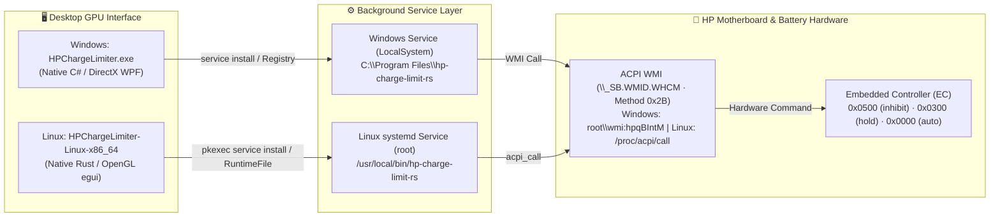

<div align="center">

<a href="README.md"></a>&nbsp;&nbsp;<a href="README.en.md"></a>

<br /><br />


# ⚡ HP Battery Charge Limiter

A modern, **zero-install**, **GPU-accelerated** desktop control center that enables hardware-level battery charge limiting for **HP Victus, OMEN, and Pavilion** laptops on **Windows 10/11 (DirectX WPF GPU)** and **Linux (Rust OpenGL/egui GPU)**.

<p align="center">
  <a href="../../releases/latest"></a>&nbsp;
  <a href="#-linux-setup--usage-native-openglegui-gpu"></a>&nbsp;
  <a href="https://github.com/kralonur/hp-charge-limit-rs"></a>&nbsp;
  <a href="#-key-features"></a>&nbsp;
  <a href="#-ai-assisted-development--credits"></a>&nbsp;
  <a href="#-license--legal-compliance"></a>
</p>

[**📥 Download (Releases)**](../../releases/latest) &nbsp;·&nbsp; [**🪟 Windows Guide**](#-windows-setup--usage-native-directx-wpf) &nbsp;·&nbsp; [**🐧 Linux Guide**](#-linux-setup--usage-native-openglegui-gpu) &nbsp;·&nbsp; [**❓ FAQ**](#-frequently-asked-questions-faq) &nbsp;·&nbsp; [**📦 Changelog**](docs/CHANGELOG.md)

</div>

---

## 🪟 Windows Setup & Usage (Native DirectX WPF)

### 1. No Installer Wizard (`.msi` / Setup) Required!
The Windows edition is a **single portable executable** (`HPChargeLimiter.exe` — only **`1.57 MB`**). You do **not** need to install Python, Rust, or any external driver package. The background Rust service (`hp-charge-limit-rs.exe`) is embedded directly inside this `.exe`.

### 2. Step-by-Step Usage (30 Seconds)
1. Download **`HPChargeLimiter.exe`** from the [**Releases**](../../releases/latest) section on the right and double-click to launch it.
2. Click **`EN`** in the top-right corner to switch the interface to English (your choice is saved automatically).
3. Under **Charge Limit & Thresholds**, select a Quick Preset (or customize the Stop/Start sliders):
   * **60% Desktop (`60% Stop / 55% Start`):** Best if your laptop stays plugged in 24/7 to minimize long-term chemical aging.
   * **80% Balanced — *Recommended* (`80% Stop / 75% Start`):** Ideal balance between daily unplugged runtime and battery longevity.
   * **90% Travel (`90% Stop / 85% Start`):** High capacity before travelling while avoiding peak 100% voltage stress.
4. Click **"💾 Save & Apply to Windows Service"** *(approve the Windows UAC prompt)*.
5. **That's it!** The top-right status badge will turn green: **`Service: RUNNING`**.

### 3. What Happens If I Close the App or Delete the `.exe`?
> [!IMPORTANT]
> Once you click **"Save & Apply to Windows Service"**, the application automatically extracts its embedded core engine to **`C:\Program Files\hp-charge-limit-rs\hp-charge-limit-rs.exe`** and registers it as a native **Windows Service (`LocalSystem`)**.
>
> * **Even if you completely close the GUI (`HPChargeLimiter.exe`)**, the background service keeps enforcing your limit 24/7.
> * **Even if you delete the downloaded `HPChargeLimiter.exe` file**, your charge limit remains active across every reboot.
> * To completely remove the service and all files with zero leftovers, open **🖥️ System & Preferences -> 🧹 Full Uninstall & Clean All Leftovers**.

---

## 🐧 Linux Setup & Usage (Native OpenGL/egui GPU)

The Linux edition (**`HPChargeLimiter-Linux-x86_64`**) is **100% GPU-accelerated** (**Pure Rust + `eframe` / `egui` OpenGL at 144Hz/165Hz**, native Wayland & X11 support) and embeds the `hp-charge-limit-rs` core daemon directly inside the single executable.

### 1. Download & Launch
Download **`HPChargeLimiter-Linux-x86_64`** from [**Releases**](../../releases/latest), make it executable, and run it:

```bash
chmod +x HPChargeLimiter-Linux-x86_64
./HPChargeLimiter-Linux-x86_64
```

### 2. One-Click `acpi_call` Kernel Module Auto-Installer
On Linux, communicating with the HP Embedded Controller (`\_SB.WMID.WHCM`) requires the **`acpi_call`** kernel module. **You do not need to hunt for terminal packages manually:**
* If `/proc/acpi/call` is not active on your system, an orange banner appears at the top of the app with a **"🔧 Auto-Install & Enable `acpi_call`"** button.
* Clicking this button automatically detects your Linux distribution (**Ubuntu / Debian / Linux Mint / Pop!_OS**, **Arch / Manjaro / EndeavourOS**, **Fedora**, or **openSUSE**), prompts via `pkexec`, installs the appropriate `acpi-call-dkms` package, loads `modprobe acpi_call` immediately, and writes `/etc/modules-load.d/hp-charge-limit-rs.conf` so it loads on every boot.

### 3. `systemd` Service Management & Full Cleanup
* Clicking **"💾 Save & Apply to Service (`systemd`)"** extracts the embedded daemon to `/usr/local/bin/hp-charge-limit-rs` and registers it as an official **`systemd` service** (listening to real-time D-Bus `UPower` AC adapter events).
* Even after closing the GUI, the `systemd` service runs in the background across reboots.
* Under **🖥️ System & Preferences**, click **"🧹 Full Uninstall & Clean All Leftovers"** to reset the motherboard EC back to `100% Normal Charge (auto)` and remove `/usr/local/bin/hp-charge-limit-rs`, `/etc/systemd/system/hp-charge-limit-rs.service`, `/var/lib/hp-charge-limit-rs`, and `/var/log/hp-charge-limit-rs` in one click.

---

## ❓ Frequently Asked Questions (FAQ)

* **My battery is currently at 91%, and I set the limit to 80%. Why isn't it discharging down to 80%?**
  * This is **completely normal and by design**. Hardware charge inhibition (`Inhibit`) does not forcefully discharge your battery; instead, it cuts charging current to **`0.00 W`** and runs the laptop directly off AC adapter power. Force-discharging would waste battery cycle life, so the battery is held steady at its current level (91%). Once you use the laptop on battery below 80%, it will stop at 80% from then on.
* **I'm about to travel. Can I charge to 100% just once without losing my saved settings?**
  * Yes! Simply toggle on **"⚡ Temporary 100% Charge (Bypass)"** on the main screen. Your battery will charge to 100%. The next time you restart your PC, Bypass automatically turns off and your normal charge limit is restored.
* **Which HP laptop models are supported?**
  * Works on **HP Victus 15 / 16**, **HP OMEN 16 / 17**, and modern **HP Pavilion Gaming / Aero** laptops that expose the `\_SB.WMID.WHCM` (method `0x2B` — `root\wmi:hpqBIntM` on Windows, `/proc/acpi/call` on Linux) interface. You can verify your hardware compatibility anytime via **🛠️ Tools & Diagnostics -> Run Diagnostics**.

---

## ✨ Key Features

* **🚀 100% GPU-Accelerated Native UI on Windows & Linux:** Powered by native **DirectX WPF (`1.57 MB`)** on Windows and **Pure Rust `eframe`/`egui` OpenGL** on Linux. Runs at **144Hz / 165Hz** with zero input lag and launches in `< 80 ms`.
* **☀️ / 🌙 Dark & Light Theme:** Instantly toggle between Dark Mode (Obsidian) and Light Mode (Slate).
* **🌐 Bilingual Interface (`TR` / `EN`):** Instant switching between English and Turkish with a fixed-grid layout so buttons and badges never shift.
* **ⓘ Smart Power-User Info Badges:** Hover or click the **`ⓘ`** badge next to any setting for a clear, concise explanation without overwhelming jargon.
* **🧪 Live Charge Flow Test (`--watch`) & Hardware Diagnostics (`diagnose`):** Samples real-time battery energy (`mWh`/`µWh` and `Watts`) to verify that charging current is physically blocked on your motherboard.

---

## 🏗️ System Architecture (Windows & Linux)



---

## 📂 Repository Layout

```text
├── .github/
│   └── workflows/
│       └── release.yml                  # 🤖 Automated Windows (.exe) & Linux (x86_64) GitHub Release builder
│
├── src/
│   ├── v2-native-wpf/                   # 🪟 Windows Native C# / DirectX WPF Source Code
│   │   ├── Program.cs                   # Single-instance mutex, DPI v2 & entry point
│   │   ├── MainWindow.cs                # DirectX GPU UI, Dark/Light theme, 5 tabs, system tray
│   │   ├── Backend.cs                   # Win32 P/Invoke, WMI/CLI bridge, Full Cleanup engine
│   │   ├── I18n.cs                      # Bilingual (TR / EN) dictionary
│   │   ├── app_icon.ico                 # Multi-layer (16px..256px) Fluent app icon
│   │   ├── build.ps1                    # Single-command C# / WPF build script (csc.exe)
│   │   └── core/
│   │       └── hp-charge-limit-rs.exe   # Upstream v0.4.1 Rust binary embedded at compile time
│   │
│   └── linux-native-egui/               # 🐧 Linux Native Rust / OpenGL (eframe/egui) Source Code
│       ├── Cargo.toml                   # eframe 0.29 (glow OpenGL, Wayland & X11) configuration
│       ├── build.rs                     # Embeds the Linux hp-charge-limit-rs core binary at compile time
│       └── src/
│           ├── main.rs                  # OpenGL GPU UI, Dark/Light theme, 5 tabs, acpi_call wizard
│           ├── backend.rs               # sysfs/systemd bridge, 1-click acpi_call installer, Full Cleanup
│           └── i18n.rs                  # Linux bilingual (TR / EN) dictionary
│
├── hp-charge-limit-rs-source/           # 🦀 v0.4.1 Upstream Rust Source Code (kralonur/hp-charge-limit-rs)
│
├── docs/
│   ├── logo.png                         # Application logo
│   ├── badges/                          # Smooth rounded SVG pill badges
│   ├── CHANGELOG.md                     # Release history
│   └── README_UPSTREAM.md               # Original hp-charge-limit-rs documentation
│
├── README.md                            # 🇹🇷 Turkish Documentation
├── README.en.md                         # 🇬🇧 English Documentation
├── LICENSE-MIT                          # Full MIT License text
├── LICENSE-APACHE                       # Full Apache 2.0 License text
├── NOTICE                               # Apache 2.0 Section 4 attribution & modification notice
└── THIRD_PARTY_NOTICES.md               # Third-party open-source notices
```

---

## 🔗 Upstream Source & Attribution

The hardware communication core and background service (**daemon**) of this project are built upon the open-source **`hp-charge-limit-rs`** project created by **Onur Kral ([@kralonur](https://github.com/kralonur))** and contributors:

* **Original (Upstream) GitHub Repository:** [**https://github.com/kralonur/hp-charge-limit-rs**](https://github.com/kralonur/hp-charge-limit-rs)
* **Core Engine Version:** `v0.4.1` (Commit: `3cdff25dd11b05797b8f56a393a58fcc3e8d3a2c`)
* **Core Source Code:** [`hp-charge-limit-rs-source/`](hp-charge-limit-rs-source/) *(Preserved unmodified for hardware/EC safety)*
* **Original Documentation:** [`docs/README_UPSTREAM.md`](docs/README_UPSTREAM.md)

---

## 🤖 AI-Assisted Development & Credits

The native desktop graphical user interfaces for Windows (**Native C# / DirectX WPF**) and Linux (**Native Rust / OpenGL `egui`**), the one-click `acpi_call` auto-installer, Dark/Light theme engine, bilingual (`TR`/`EN`) architecture, zero-residue uninstaller (`FullSystemCleanup`), and documentation were co-developed with **Google Gemini (Argon) / Antigravity AI** (*AI-Assisted / Vibe-Coding*):

* **Core Rust Engine & ACPI WMI Research (`v0.4.1`):** [Onur Kral (@kralonur)](https://github.com/kralonur) — [`hp-charge-limit-rs`](https://github.com/kralonur/hp-charge-limit-rs)
* **Desktop Control Center (Windows & Linux), Visual UI & System Integration (`v1.0` – `v2.5`):** Designed, engineered, and security-audited in collaboration with **Google Gemini (Argon)** & **Antigravity AI**.

---

## 🛠️ Build from Source

### Windows (PowerShell — 2 Seconds)
Compiles in 2 seconds using Windows 10/11's built-in 64-bit `.NET Framework` compiler with zero external SDK downloads required:
```powershell
powershell -ExecutionPolicy Bypass -File .\src\v2-native-wpf\build.ps1
```

### Linux (Cargo — OpenGL/egui Standalone Binary)
```bash
# 1. Build the core daemon and place it in the GUI embedding folder:
cargo build --release --manifest-path hp-charge-limit-rs-source/Cargo.toml
mkdir -p src/linux-native-egui/core
cp hp-charge-limit-rs-source/target/release/hp-charge-limit-rs src/linux-native-egui/core/

# 2. Build the GPU-accelerated Linux desktop GUI:
cargo build --release --manifest-path src/linux-native-egui/Cargo.toml
```
*(Note: The included [`.github/workflows/release.yml`](.github/workflows/release.yml) GitHub Actions workflow automatically compiles and attaches both the Windows `.exe` and Linux `x86_64` binary whenever you publish a new tag/release.)*

---

## 📜 License & Legal Compliance

In accordance with upstream [**`hp-charge-limit-rs`**](https://github.com/kralonur/hp-charge-limit-rs), this project is dual-licensed under either the **MIT License** or the **Apache License (Version 2.0)** (**`MIT OR Apache-2.0`**):

* **MIT License:** [`LICENSE-MIT`](LICENSE-MIT)
* **Apache License 2.0:** [`LICENSE-APACHE`](LICENSE-APACHE)
* **Attribution & Modification Notice (Apache 2.0 Section 4):** [`NOTICE`](NOTICE)
* **Third-Party Open-Source Notices:** [`THIRD_PARTY_NOTICES.md`](THIRD_PARTY_NOTICES.md)
* **Changelog:** [`docs/CHANGELOG.md`](docs/CHANGELOG.md)
