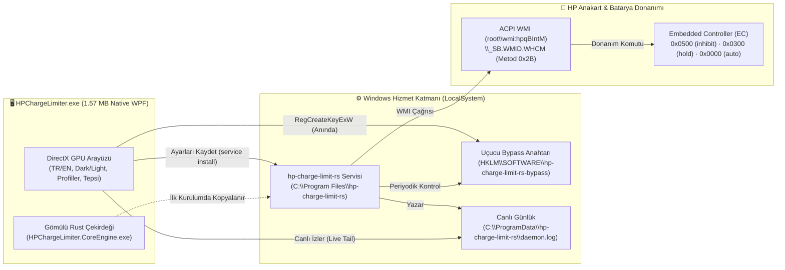

<div align="center">

<a href="README.md"></a>&nbsp;&nbsp;<a href="README.en.md"></a>

<br /><br />


# ⚡ HP Battery Charge Limiter

**HP Victus, OMEN ve Pavilion** dizüstü bilgisayarlar için BIOS'ta bulunmayan batarya şarj sınırlandırma özelliğini donanımsal olarak etkinleştiren, **kurulum gerektirmeyen (`1.57 MB` tek `.exe`)**, **DirectX GPU hızlandırmalı** modern masaüstü kontrol merkezi.

<p align="center">
  <a href="../../releases/latest"></a>&nbsp;
  <a href="https://github.com/kralonur/hp-charge-limit-rs"></a>&nbsp;
  <a href="#-öne-çıkan-özellikler"></a>&nbsp;
  <a href="#-yapay-zeka-katkısı--geliştirme-süreci"></a>&nbsp;
  <a href="#-lisans-ve-yasal-bildirimler"></a>
</p>

[**📥 İndir (Releases)**](../../releases/latest) &nbsp;·&nbsp; [**💡 Kurulum & Kullanım**](#-kurulum-gerekir-mi-nasıl-kullanılır) &nbsp;·&nbsp; [**❓ Sıkça Sorulan Sorular**](#-sıkça-sorulan-sorular-sss) &nbsp;·&nbsp; [**📦 Sürüm Geçmişi**](docs/CHANGELOG.md) &nbsp;·&nbsp; [**🔗 Ana Kaynak**](#-ana-kaynak-upstream-source-ve-atıf)

</div>

---

## 💡 Kurulum Gerekir mi? Nasıl Kullanılır?

### 1. Kurulum Sihirbazı (`.msi` / Setup) Gerekmez!
Bu program **tek bir taşınabilir (`.exe`) dosyadan** (`HPChargeLimiter.exe` — yalnızca **`1.57 MB`**) oluşur. Bilgisayarınıza Python, Rust veya harici bir sürücü paketi kurmanıza **gerek yoktur**. Arka plan Rust servisi (`hp-charge-limit-rs.exe`), doğrudan bu `.exe` dosyasının içine gömülüdür.

### 2. Adım Adım Kullanım (30 Saniye)
1. Sağ taraftaki [**Releases (Sürümler)**](../../releases/latest) bölümünden **`HPChargeLimiter.exe`** dosyasını indirin ve çift tıklayarak açın.
2. Sağ taraftaki **Şarj Limiti ve Eşik Ayarları** bölümünden kullanım senaryonuza uygun bir profil seçin (veya kaydırma çubuklarıyla kendi yüzdelerinizi belirleyin):
   * **%60 Masaüstü (`%60 Durdur / %55 Başlat`):** Bilgisayarı sürekli fişe takılı kullanıyorsanız batarya ömrünü maksimum düzeyde korur.
   * **%80 Dengeli — *Önerilen* (`%80 Durdur / %75 Başlat`):** Günlük kullanım ve uzun batarya sağlığı için ideal denge.
   * **%90 Seyahat (`%90 Durdur / %85 Başlat`):** Dışarı çıkmadan önce yüksek kapasite sağlar, %100 voltaj stresinden kaçınır.
3. **"💾 Ayarları Kaydet ve Servise Uygula"** butonuna basın *(Windows Yönetici onayı isteyecektir, Evet deyin)*.
4. **Hepsi bu kadar!** Sağ üstteki durum rozeti **`Servis: ÇALIŞIYOR`** olarak yeşile dönecektir.

### 3. Programı Kapatırsam veya `.exe` Dosyasını Silersem Ne Olur?
> [!IMPORTANT]
> **"Ayarları Kaydet ve Servise Uygula"** butonuna bir kez bastığınızda, uygulama kendi içindeki çekirdek motoru otomatik olarak **`C:\Program Files\hp-charge-limit-rs\hp-charge-limit-rs.exe`** konumuna kopyalar ve resmi bir **Windows Hizmeti (`LocalSystem`)** olarak kaydeder.
>
> Bu sayede:
> * **Arayüzü (`HPChargeLimiter.exe`) tamamen kapatsanız bile** arka plan servisi çalışmaya devam eder.
> * İndirdiğiniz `HPChargeLimiter.exe` dosyasını masaüstünden veya İndirilenler klasöründen **silseniz bile**, bilgisayarınızı her açtığınızda (daha Windows oturumu açılmadan önce) son kaydettiğiniz şarj limiti otomatik olarak uygulanır.
> * İsterseniz **Sistem & Tercihler** sekmesinden *"Windows açıldığında arayüzü tepside başlat"* seçeneğini açarak sağ alt bildirim alanında (System Tray) her zaman elinizin altında tutabilirsiniz.

### 4. Tamamen Kaldırma ve Sıfırlama (Sıfır Kalıntı)
Programı ve arka plan servisini bilgisayarınızdan tamamen kaldırmak isterseniz:
1. `HPChargeLimiter.exe` uygulamasını açıp **🖥️ Sistem & Tercihler** sekmesine geçin.
2. **"🧹 Tam Kaldır & Tüm Kalıntıları Temizle"** butonuna tıklayın.
3. Bu işlem tek tıkla:
   * Anakart şarj kontrolcüsünü fabrika ayarına (**%100 normal şarj — `auto`**) döndürür,
   * Windows Hizmetini (`hp-charge-limit-rs`) durdurur ve siler,
   * `C:\Program Files\hp-charge-limit-rs`, `C:\ProgramData\hp-charge-limit-rs` ve `%APPDATA%\HPChargeLimiter` klasörlerini ve kayıt defteri (Registry) girdilerini **hiçbir kalıntı bırakmadan** temizler.

---

## ❓ Sıkça Sorulan Sorular (SSS)

* **Pilim şu an %91 seviyesinde, sınırı %80 yaptım ama neden %80'e düşmüyor (deşarj olmuyor)?**
  * Bu **tamamen normal ve olması gereken** davranıştır. Şarj kesme (`Inhibit`) modu bataryayı zorla boşaltmaz (deşarj etmez); bataryaya giden şarj akımını **`0.00 W`** olarak keser ve bilgisayarın tüm gücünü doğrudan adaptörden çeker. Zorla deşarj edip tekrar doldurmak batarya döngü ömrünü harcayacağı için piliniz mevcut seviyesinde (%91) sabit tutulur. Bilgisayarı pilde biraz kullanıp %80'in altına düşürdüğünüzde bir daha %80'i geçmeyecektir.
* **Seyahate çıkacağım, ayarlarımı bozmadan tek seferlik %100 şarj edebilir miyim?**
  * Evet! Ana ekrandaki **"⚡ Geçici %100 Şarj Modu (Bypass)"** anahtarını açmanız yeterlidir. Bataryanız %100'e kadar dolar. Bilgisayarı yeniden başlattığınızda Bypass otomatik olarak kapanır ve eski limitiniz (%80 vb.) kendiliğinden devreye girer.
* **Hangi HP modelleri destekleniyor?**
  * ACPI WMI tablosunda `root\wmi:hpqBIntM` (`\_SB.WMID.WHCM`, metod `0x2B`) arayüzünü barındıran **HP Victus 15 / 16**, **HP OMEN 16 / 17** ve güncel **HP Pavilion Gaming / Aero** modelleriyle çalışır. Uyumluluğu uygulama içindeki **🛠️ Test & Tanılama -> Tanılamayı Çalıştır** butonuyla anında görebilirsiniz.

---

## ✨ Öne Çıkan Özellikler

* **🚀 DirectX GPU Hızlandırmalı Arayüz (`1.57 MB`):** Python/Electron gibi ağır paketler yerine Windows'un yerleşik **WPF (`PresentationFramework` / DirectX)** motoruyla yazılmıştır. **144Hz / 165Hz** ekranlarda sıfır gecikmeyle çalışır ve `< 80 ms` içinde açılır.
* **☀️ / 🌙 Karanlık ve Aydınlık Tema (Dark / Light Mode):** Üst çubuktaki tema butonu ile Windows 11 pencere başlığı dahil tüm arayüz anında Karanlık veya Aydınlık moda geçer.
* **🌐 Çift Dil Desteği (`TR` / `EN`):** Tek tıkla Türkçe ve İngilizce arasında anında geçiş yapar; arayüz ızgarası sabitlendiği için dil değişiminde hiçbir buton veya rozet kaymaz.
* **ⓘ Akıllı Bilgi Rozetleri:** Her ayarın yanındaki **`ⓘ`** rozetine geldiğinizde veya tıkladığınızda, karmaşık teknik jargon olmadan doğrudan o ayarın ne işe yaradığını anlatan sade açıklamalar gösterilir.
* **🧪 Canlı Şarj Akış Testi (`--watch`) & Donanım Tanılama (`diagnose`):** Bataryaya giren enerjiyi (`mWh` ve `Watt`) saniye saniye ölçerek donanımınızda şarjın gerçekten kesildiğini doğrular.

---

## 🏗️ Çalışma Mimarisi



---

## 📂 Proje Dizin Yapısı

```text
├── src/
│   └── v2-native-wpf/                   # 🚀 Native C# / DirectX WPF Kaynak Kodları
│       ├── Program.cs                   # Tekil örnek (Mutex), DPI v2 ve giriş noktası
│       ├── MainWindow.cs                # DirectX GPU arayüzü, Dark/Light tema, 5 sekme, sistem tepsisi
│       ├── Backend.cs                   # Win32 P/Invoke, WMI/CLI köprüsü, Tam Temizlik motoru
│       ├── I18n.cs                      # Türkçe (TR) ve İngilizce (EN) dil sözlüğü
│       ├── app_icon.ico                 # Çoklu katmanlı (16px..256px) Fluent uygulama simgesi
│       ├── build.ps1                    # Tek komutla C# / WPF derleme betiği (csc.exe)
│       └── core/
│           └── hp-charge-limit-rs.exe   # Derleme sırasında .exe içine gömülen v0.4.1 Rust çekirdeği
│
├── hp-charge-limit-rs-source/           # 🦀 v0.4.1 Upstream Rust Kaynak Kodları (kralonur/hp-charge-limit-rs)
│
├── docs/
│   ├── logo.png                         # Uygulama logosu
│   ├── badges/                          # Yuvarlatılmış modern SVG rozetler
│   ├── CHANGELOG.md                     # Sürüm geçmişi
│   └── README_UPSTREAM.md               # Orijinal hp-charge-limit-rs dokümantasyonu
│
├── README.md                            # 🇹🇷 Türkçe Dokümantasyon
├── README.en.md                         # 🇬🇧 İngilizce Dokümantasyon (English Documentation)
├── LICENSE-MIT                          # MIT Lisansı tam metni
├── LICENSE-APACHE                       # Apache 2.0 Lisansı tam metni
├── NOTICE                               # Apache 2.0 Bölüm 4 uyumlu telif ve değişiklik bildirimi
└── THIRD_PARTY_NOTICES.md               # Üçüncü parti bileşen ve lisans bildirimleri
```

---

## 🔗 Ana Kaynak (Upstream Source) ve Atıf

Bu projenin donanım haberleşme çekirdeği ve Windows arka plan servisi (**daemon**), **Onur Kral ([@kralonur](https://github.com/kralonur))** ve katkıda bulunanlar tarafından geliştirilen açık kaynaklı **`hp-charge-limit-rs`** projesine dayanmaktadır:

* **Orijinal (Upstream) GitHub Deposu:** [**https://github.com/kralonur/hp-charge-limit-rs**](https://github.com/kralonur/hp-charge-limit-rs)
* **Kullanılan Çekirdek Sürümü:** `v0.4.1` (Commit: `3cdff25dd11b05797b8f56a393a58fcc3e8d3a2c`)
* **Çekirdek Kaynak Kodları:** [`hp-charge-limit-rs-source/`](hp-charge-limit-rs-source/) *(Donanım/EC güvenliği için Rust çekirdek kodları değiştirilmeden orijinal haliyle korunmuştur)*
* **Orijinal Dokümantasyon:** [`docs/README_UPSTREAM.md`](docs/README_UPSTREAM.md)

---

## 🤖 Yapay Zeka Katkısı & Geliştirme Süreci

Bu projenin masaüstü grafik arayüzü (**Native C# / DirectX WPF GUI**), kullanıcı deneyimi (UX) tasarımı, Karanlık/Aydınlık tema motoru, çift dil (`TR`/`EN`) mimarisi, sıfır kalıntılı kaldırma sistemi (`FullSystemCleanup`) ve dokümantasyonu **Google Gemini (Argon) / Antigravity AI** ile birlikte (*AI-Assisted / Vibe-Coding* yaklaşımıyla) geliştirilmiştir:

* **Çekirdek Rust Motoru & ACPI WMI Keşfi (`v0.4.1`):** [Onur Kral (@kralonur)](https://github.com/kralonur) — [`hp-charge-limit-rs`](https://github.com/kralonur/hp-charge-limit-rs)
* **Masaüstü Kontrol Merkezi, Görsel Arayüz & Sistem Entegrasyonu (`v1.0` – `v2.4`):** **Google Gemini (Argon)** & **Antigravity AI** eşliğinde tasarlanmış, kodlanmış ve güvenlik denetiminden geçirilmiştir.

---

## 🛠️ Kaynak Koddan Derleme

Ekstra hiçbir harici SDK veya paket indirmeye gerek kalmadan Windows 10/11'in yerleşik `.NET Framework 64-bit` derleyicisiyle 2 saniye içinde derlenebilir:

```powershell
powershell -ExecutionPolicy Bypass -File .\src\v2-native-wpf\build.ps1
```

---

## 📜 Lisans ve Yasal Bildirimler

Bu proje, ana kaynak olan [**`hp-charge-limit-rs`**](https://github.com/kralonur/hp-charge-limit-rs) ile uyumlu olarak **MIT Lisansı** veya **Apache Lisansı (Sürüm 2.0)** altında çift lisanslıdır (**`MIT OR Apache-2.0`**):

* **MIT Lisansı:** [`LICENSE-MIT`](LICENSE-MIT)
* **Apache Lisansı 2.0:** [`LICENSE-APACHE`](LICENSE-APACHE)
* **Telif ve Değişiklik Bildirimi (Apache 2.0 Bölüm 4):** [`NOTICE`](NOTICE)
* **Üçüncü Parti Açık Kaynak Bildirimleri:** [`THIRD_PARTY_NOTICES.md`](THIRD_PARTY_NOTICES.md)
* **Sürüm Geçmişi:** [`docs/CHANGELOG.md`](docs/CHANGELOG.md)
